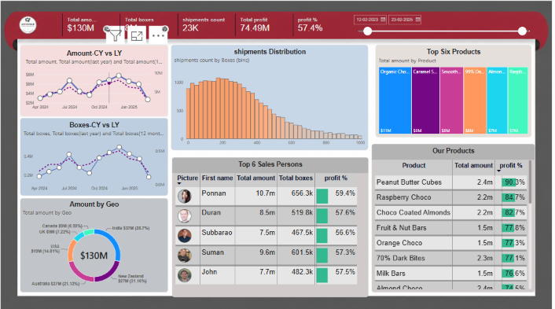

# Power BI Sales Dashboard

## Project Overview
This project presents an interactive Power BI dashboard developed to analyze sales performance and business trends. It helps users understand key metrics and identify useful insights through visualizations.

## Dashboard Screenshot

## Tools and Technologies
- Power BI
- Power Query
- Data Cleaning and Transformation
- Data Visualization
- Business Intelligence

## Key Features
- Interactive charts and graphs
- KPI cards to summarize important metrics
- Filters and slicers for exploring data
- Visual analysis of business performance

## Key Learnings
- Prepared and transformed data for analysis.
- Created visualizations to communicate insights.
- Designed an interactive dashboard for exploring data.

## Project Files
- `dashboard.png` — Screenshot of the Power BI dashboard.
